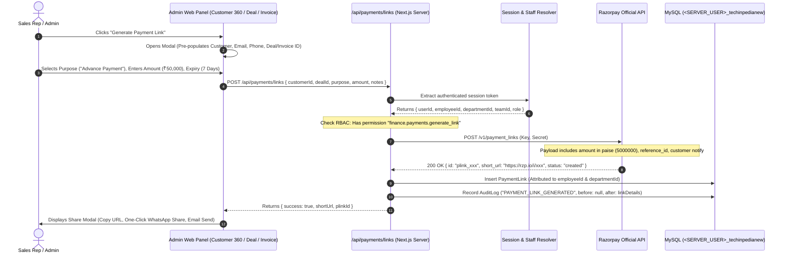
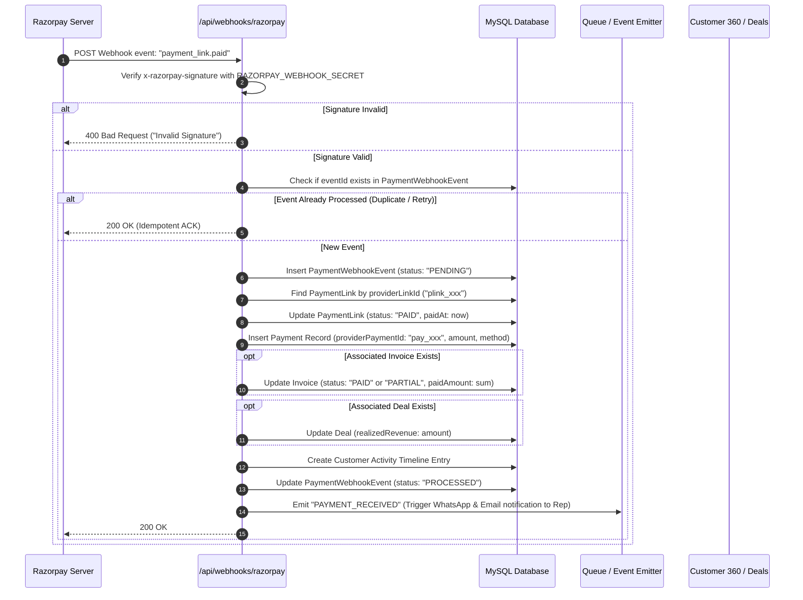

# TECHINPEDIA BUSINESS OS — RAZORPAY PAYMENT LINK & TRANSACTION ARCHITECTURE

**Document Version**: 1.0.0  
**Target Organization**: TechInPedia (~100 Employees)  
**Date**: September 18, 2026  
**Status**: Architectural Specification (Pre-Implementation)  
**Auditor**: Antigravity Core Architecture Team  

---

## 1. Architectural Overview & Design Philosophy

This document defines the complete technical architecture for integrating official **Razorpay Standard API & Payment Links** into TechInPedia. 

### Core Guarantees
1. **Zero Frontend Secret Exposure**: All interactions with Razorpay (`razorpay_key_secret`, `razorpay_webhook_secret`) occur exclusively in server-side Next.js Node.js runtimes.
2. **Authoritative Staff Attribution**: Staff identity is resolved directly from cryptographically signed session tokens; the system strictly ignores any employee ID passed from frontend request bodies.
3. **Webhook as Single Source of Truth**: Browser redirect or client callbacks are treated as informational only. A transaction is **NEVER** transitioned to `PAID` without cryptographically valid, idempotent webhook verification.
4. **Controlled Separation of Provider vs. Offline Payments**: Sales staff cannot manually mark a provider payment link as `PAID`. Cash/Cheque/NEFT offline payments follow a separate, permissioned workflow with mandatory administrative approval and audit trail.

---

## 2. Integration Mapping with Existing Modules

```mermaid
graph TD
    subgraph CRM & Sales Modules
        C[Customer 360]
        L[Lead / Enquiry]
        D[Deal / Pipeline]
        Q[Quotation]
    end

    subgraph Finance & Delivery
        I[Invoice]
        P[Project]
    end

    subgraph Identity & Staff Attribution
        U[User Session] -->|Resolved Server-Side| E[Employee Profile]
        E --> DEP[Department]
        E --> TM[Team]
    end

    subgraph Razorpay Payment Engine
        PL[PaymentLink Model]
        RP[Official Razorpay API]
        WH[/api/webhooks/razorpay]
        PAY[Payment Transaction Record]
    end

    C --> PL
    L --> PL
    D --> PL
    Q --> PL
    I --> PL
    P --> PL
    E --> PL
    DEP --> PL

    PL -->|API POST /v1/payment_links| RP
    RP -->|Customer Completes Payment| WH
    WH -->|HMAC Verified & Idempotent| PAY
    PAY -->|Update Status to PAID| PL
    PAY -->|Auto-reconcile| I
    PAY -->|Auto-update Revenue| D
    PAY -->|Timeline Event| C
```

---

## 3. Database Schema Specification (Prisma)

```prisma
model PaymentLink {
  id                  String               @id @default(cuid())
  providerLinkId      String               @unique // Razorpay plink_xxx
  providerOrderId     String?              @unique // Associated order if created
  shortUrl            String               // https://rzp.io/i/xxx
  
  // Financial Specifics
  amount              Decimal              @db.Decimal(12, 2)
  currency            String               @default("INR")
  purpose             String               // ADVANCE, MILESTONE, AMC, INVOICE, HOSTING, DOMAIN, CUSTOM
  description         String
  status              PaymentLinkStatus    @default(CREATED)
  
  // Strict Staff Attribution (Never trust client input)
  createdByUserId     String
  createdByUser       User                 @relation("CreatedPaymentLinks", fields: [createdByUserId], references: [id])
  salesEmployeeId     String?
  salesEmployee       Employee?            @relation("SalesAttributedLinks", fields: [salesEmployeeId], references: [id])
  departmentId        String?
  department          Department?          @relation(fields: [departmentId], references: [id])
  teamId              String?
  team                Team?                @relation(fields: [teamId], references: [id])
  
  // Associated Entity Relations
  customerId          String?
  customer            Customer?            @relation(fields: [customerId], references: [id], onDelete: SetNull)
  leadId              String?
  lead                Lead?                @relation(fields: [leadId], references: [id], onDelete: SetNull)
  dealId              String?
  deal                Deal?                @relation(fields: [dealId], references: [id], onDelete: SetNull)
  invoiceId           String?
  invoice             Invoice?             @relation(fields: [invoiceId], references: [id], onDelete: SetNull)
  projectId           String?
  project             Project?             @relation(fields: [projectId], references: [id], onDelete: SetNull)

  // Lifecycle Timestamps
  expiresAt           DateTime?
  cancelledAt         DateTime?
  paidAt              DateTime?
  
  // Auditing & Metadata
  providerResponse    String?              @db.LongText // Raw JSON from Razorpay API
  internalNotes       String?              @db.Text
  createdAt           DateTime             @default(now())
  updatedAt           DateTime             @updatedAt
  
  payments            Payment[]

  @@index([status, salesEmployeeId, createdAt])
  @@index([customerId, invoiceId, dealId])
}

enum PaymentLinkStatus {
  CREATED
  SENT
  PARTIALLY_PAID
  PAID
  EXPIRED
  CANCELLED
  FAILED
}

model Payment {
  id                  String               @id @default(cuid())
  paymentLinkId       String?
  paymentLink         PaymentLink?         @relation(fields: [paymentLinkId], references: [id])
  
  provider            String               @default("RAZORPAY") // RAZORPAY, MANUAL_OFFLINE, BANK_TRANSFER
  providerPaymentId   String?              @unique              // Razorpay pay_xxx
  amount              Decimal              @db.Decimal(12, 2)
  currency            String               @default("INR")
  status              String               @default("SUCCESS")  // SUCCESS, REFUNDED, FAILED
  method              String?                                   // card, netbanking, upi, wallet
  
  // Associated Business Context
  invoiceId           String?
  invoice             Invoice?             @relation(fields: [invoiceId], references: [id])
  customerId          String?
  customer            Customer?            @relation(fields: [customerId], references: [id])
  
  // Attribution & Auditing
  recordedByUserId    String
  salesEmployeeId     String?
  bankReference       String?
  rawWebhookPayload   String?              @db.LongText
  paidAt              DateTime             @default(now())
  createdAt           DateTime             @default(now())

  @@index([providerPaymentId, status])
}

model PaymentWebhookEvent {
  id                  String               @id @default(cuid())
  eventId             String               @unique // Razorpay x-razorpay-event-id
  eventType           String                       // payment_link.paid, payment.captured, etc.
  signature           String
  payloadJson         String               @db.LongText
  status              String               @default("PENDING") // PENDING, PROCESSED, FAILED, IGNORED
  errorMessage        String?              @db.Text
  receivedAt          DateTime             @default(now())
  processedAt         DateTime?

  @@index([eventId, status])
}
```

---

## 4. End-to-End Payment Link Generation Flow



---

## 5. Webhook Processing & Security Architecture

### 5.1 Webhook Endpoint Contract
- **Route**: `POST /api/webhooks/razorpay`
- **Headers**:
  - `x-razorpay-signature`: Cryptographic HMAC-SHA256 signature generated by Razorpay.
  - `x-razorpay-event-id`: Unique identifier for the webhook event.
- **Payload Handling**: Must be captured as **raw buffer / unparsed text** to prevent JSON whitespace deserialization attacks during signature verification.

### 5.2 Cryptographic Verification Algorithm
```typescript
import crypto from 'crypto';

export function verifyRazorpaySignature(
  rawBody: string,
  signature: string,
  secret: string
): boolean {
  const expectedSignature = crypto
    .createHmac('sha256', secret)
    .update(rawBody)
    .digest('hex');
  
  // Timing-safe buffer comparison to prevent side-channel timing attacks
  return crypto.timingSafeEqual(
    Buffer.from(expectedSignature, 'utf8'),
    Buffer.from(signature, 'utf8')
  );
}
```

### 5.3 Idempotency & Reconciliation Sequence


---

## 6. Payment Attribution & Management Reporting

Management must have real-time visibility into collection attribution. The schema supports the following reporting dimensions without complex joins:

| Reporting Dimension | Resolution Mechanism | Management Query Capability |
| :--- | :--- | :--- |
| **Who generated the request?** | `PaymentLink.createdByUserId` -> `User.name` | Track administrative output and draft velocity. |
| **Which employee brought the payment?** | `PaymentLink.salesEmployeeId` -> `Employee.name` | Calculate sales commissions and performance vs. targets. |
| **Which department & team?** | `PaymentLink.departmentId`, `PaymentLink.teamId` | Departmental collection vs. quarterly target breakdown. |
| **Which customer & service?** | `PaymentLink.customerId`, `PaymentLink.purpose` | Revenue per customer tier; revenue per service offering (Hosting vs App Dev). |
| **Which deal & invoice?** | `PaymentLink.dealId`, `PaymentLink.invoiceId` | Pipeline conversion velocity and days sales outstanding (DSO). |
| **Audit trail of payment?** | `Payment.providerPaymentId`, `Payment.paidAt`, `Payment.method` | Verified banking reconciliation and dispute defense. |

---

## 7. User Experience & Modal Design

### 7.1 Payment Link Modal Form Specification
Accessible via a single click from Customer 360, Invoices, Quotations, and Deals:
- **Header**: `Generate Razorpay Payment Link`
- **Pre-filled Context (Read-Only)**:
  - Client Name & Company
  - Client Email & Phone (Editable if missing)
  - Sales Attribution: *Generated by: [Current Logged-in Staff] ([Department])*
- **Input Fields**:
  - **Payment For (Dropdown)**: Advance Payment, Project Milestone, AMC Renewal, Website Development, Mobile App Development, Domain/Hosting, Invoice Payment, Custom.
  - **Amount (INR)**: Auto-filled from invoice/deal balance or manually entered.
  - **Expiry Duration**: 24 Hours, 3 Days, 7 Days (Default), 30 Days.
  - **Description / Message**: Notes sent to client on Razorpay hosted checkout page.
  - **Internal Notes**: Private notes visible only to internal staff.
- **Action Buttons**:
  - `Cancel`
  - `Generate Official Link` (Triggers server API call with loading state).

### 7.2 Post-Generation Action Card
Immediately upon generation:
- Displays shortened URL: `https://rzp.io/i/xY7zAb`
- One-click actions:
  - **Copy Link**: Copies URL to clipboard with confirmation toast.
  - **Send via WhatsApp**: Opens WhatsApp Web / Desktop with formatted message template:
    > *"Dear [Client Name], here is the secure payment link for [Purpose] amounting to ₹[Amount]: [URL]. Valid until [Expiry]. Thank you, TechInPedia Team."*
  - **Send via Email**: Dispatches official branded email template via Resend/SMTP.

---

## 8. Security Directives & Compliance Checklist

- [x] **No Client-Side Secrets**: `RAZORPAY_KEY_ID` and `RAZORPAY_KEY_SECRET` stored in server environment variables only.
- [x] **Session-Enforced Attribution**: Server discards any client-supplied `salesEmployeeId` or `userId` and binds the authenticated JWT session context.
- [x] **HMAC Timing-Safe Verification**: Avoid standard string `===` comparison on webhook signatures; use `crypto.timingSafeEqual`.
- [x] **Disabled Manual "Mark as Paid"**: UI buttons to manually transition a Razorpay payment link to `PAID` are prohibited. Offline cash/bank payments must use a separate `RECORD_OFFLINE_PAYMENT` route requiring `finance.payments.record_offline` permission.
- [x] **Amount Validation**: Minimum transaction limit enforced (₹1.00 / 100 paise) and positive currency checks.
