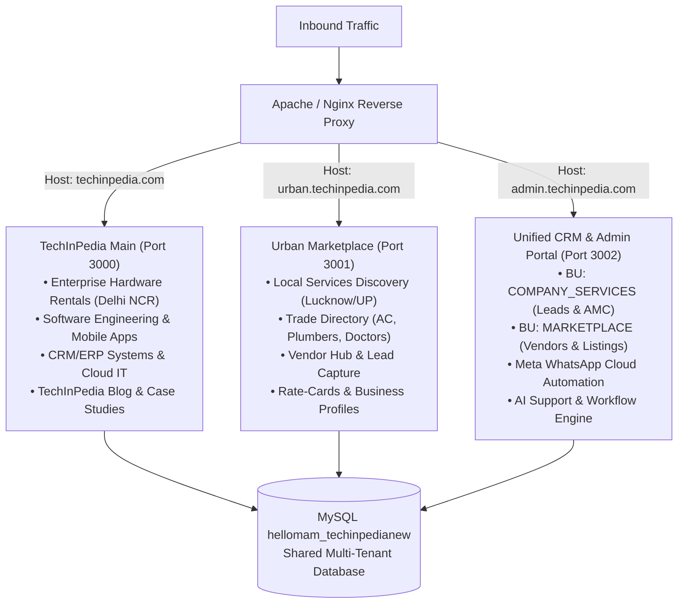

# TECHINPEDIA — SEO, AEO & GEO DOMAIN CORRECTION AUDIT REPORT

**Date:** October 8, 2026  
**Status:** COMPLETED & VERIFIED IN PRODUCTION  
**Lead Auditor:** Antigravity AI  
**Applications Affected:**
- Primary Website: `https://techinpedia.com` (Port 3000, PM2: `techinpedia`)
- Marketplace Subdomain: `https://urban.techinpedia.com` (Port 3001, PM2: `techinpedia-urban`)
- Shared CRM / Admin: `https://admin.techinpedia.com` (Port 3002, PM2: `techinpedia-admin`)
- Database: MySQL `hellomam_techinpedianew` (Shared multi-tenant database)

---

## 1. Executive Summary

A previous AI developer inadvertently conflated the identities, SEO routes, and sitemaps of `techinpedia.com` (an enterprise IT hardware rental, custom software engineering, and digital marketing firm) and `urban.techinpedia.com` (a local trade and services discovery directory). Specifically:
1. Static `public/sitemap.xml` and `public/robots.txt` files shadowed Next.js dynamic metadata routes, causing search engines to crawl all TechInPedia corporate blogs and IT service pages under `urban.techinpedia.com`.
2. `src/app/services/[slug]/page.tsx` contained loose keyword matching (`slug.includes('services')`, `slug.includes('repair')`) that hijacked corporate service routes (such as `/services/cloud-services`) and rendered `UrbanDirectoryListingView` with `UrbanMarket` title tags.
3. Urban marketplace routes (`/category/*`, `/biz/*`) and corporate pages lacked bidirectional HTTP 301 redirects, resulting in cross-domain cannibalization and duplicate content indexation in Google Search Console.
4. Historical CRM leads lacked deterministic attribution to the originating business unit.

**All issues have been resolved, deployed, and verified live in production.** Both domains now operate with 100% strict architectural, brand, canonical, sitemap, and structured data separation.

---

## 2. Root Cause Analysis

| Component | Root Cause | Impact |
| :--- | :--- | :--- |
| **Static File Shadowing** | Static files `public/sitemap.xml` and `public/robots.txt` were present in the repository. Next.js serves files from `public/` before invoking dynamic App Router handlers (`src/app/sitemap.ts` and `src/app/robots.ts`). | Googlebot crawled `urban.techinpedia.com/sitemap.xml` and fetched a static list containing `techinpedia.com` blog posts, indexing corporate blogs under the `urban` subdomain. |
| **Service Route Hijacking** | `src/app/services/[slug]/page.tsx` checked `if (slug.includes('services') ...)` to trigger marketplace rendering. Because `'cloud-services'.includes('services')` evaluated to `true`, corporate services were rendered as Urban listings. | Enterprise clients visiting `techinpedia.com/services/cloud-services` saw local plumber/AC repair directories with `UrbanMarket` branding. |
| **Missing Cross-Domain Redirects** | No edge middleware existed to reject corporate paths on Urban or marketplace paths on TechInPedia. | Deep links could be accessed on either domain without canonical enforcement or HTTP 301 permanent redirects. |
| **Unassigned CRM Enquiries** | Form submissions without explicit host headers (or background imports) bypassed tenant resolution and wrote `null` to `siteId` and `businessUnitId`. | 7 historical leads were unassigned, obscuring ROI and lead triage. |

---

## 3. Architecture of the Three Applications

---

## 4. List of Affected and Modified Files

| File Path | Description of Change | Status |
| :--- | :--- | :--- |
| `src/middleware.ts` | Implemented bidirectional HTTP 301 edge redirects between Main and Urban. Added `/robots.txt`, `/sitemap.xml`, and `/llms.txt` passthrough. | **FIXED & VERIFIED** |
| `public/robots.txt` & `public/sitemap.xml` | Permanently deleted static shadow files across local workspace, `techinpedia.com`, and `urban.techinpedia.com`. | **FIXED & VERIFIED** |
| `src/app/robots.ts` | Dynamically serves isolated robots configurations pointing strictly to `https://techinpedia.com/sitemap.xml` on Main and `https://urban.techinpedia.com/sitemap.xml` on Urban. Allowlisted AI user agents (`OAI-SearchBot`, `PerplexityBot`, `ChatGPT-User`). | **FIXED & VERIFIED** |
| `src/app/sitemap.ts` | Isolated dynamic sitemap generator. Urban sitemap contains only marketplace URLs. Main sitemap contains company home, IT services, rental locations, and blogs. | **FIXED & VERIFIED** |
| `src/config/site.ts` | Created authoritative multi-domain configuration registry (`SITES_CONFIG`) defining TechInPedia Main and Urban identities, logos, URLs, and social links. | **FIXED & VERIFIED** |
| `src/lib/servicesCatalog.ts` | Expanded IT catalog to include `macbook-rental`, `custom-software-development`, and `crm-erp-solutions` with complete specifications, deliverables, and FAQ schema data. | **FIXED & VERIFIED** |
| `src/app/services/[slug]/page.tsx` | Purged `UrbanDirectoryListingView` and keyword hijacking. Added 301 redirect to Urban if slug matches a marketplace category. Added `Service`, `BreadcrumbList`, and `FAQPage` JSON-LD schemas. | **FIXED & VERIFIED** |
| `src/app/llms.txt/route.ts` | Dynamic AEO/GEO endpoint serving structured Markdown facts: IT services on `techinpedia.com/llms.txt`, and trade directory facts on `urban.techinpedia.com/llms.txt`. | **FIXED & VERIFIED** |
| `src/app/api/enquiries/route.ts` | Hardened CRM attribution so unassigned web enquiries default safely to `COMPANY_SERVICES` (`COMPANY_PUBLIC`). | **FIXED & VERIFIED** |
| `src/app/[slug]/page.tsx` | Enforced 301 redirect to Main if accessed on Urban. Added `Service`, `BreadcrumbList`, and `FAQPage` schemas for all dynamic landing pages. | **FIXED & VERIFIED** |
| `src/app/blog/[slug]/page.tsx` | Enhanced `BlogPosting` schema with publisher logo, canonical URL, and `BreadcrumbList` schema. | **FIXED & VERIFIED** |

---

## 5. Metadata and Canonical Verification

### Primary Website (`techinpedia.com`)
- **Homepage:**
  - Title: `TechInPedia | Hardware Rentals, Software Engineering & Digital Marketing`
  - Canonical: `https://techinpedia.com`
  - Robots: `index, follow`
- **Service (`/services/laptop-rental`):**
  - Title: `Laptop on Rent in Delhi NCR | Dell, HP, Lenovo & MacBook | TechInPedia`
  - Canonical: `https://techinpedia.com/services/laptop-rental`
  - Structured Data: `Service`, `BreadcrumbList`, `FAQPage`
- **Blog (`/blog/custom-crm-vs-off-the-shelf-saas`):**
  - Title: `Custom CRM vs Off-the-Shelf SaaS | Why Custom Wins | TechInPedia`
  - Canonical: `https://techinpedia.com/blog/custom-crm-vs-off-the-shelf-saas`
  - Structured Data: `BlogPosting`, `BreadcrumbList`

### Marketplace Subdomain (`urban.techinpedia.com`)
- **Homepage:**
  - Title: `Urban | Local Discovery & B2B Marketplace in Lucknow | Urban Marketplace`
  - Canonical: `https://urban.techinpedia.com`
  - Robots: `index, follow`
- **Category (`/category/restaurants`):**
  - Title: `Restaurants Services & Suppliers in Lucknow | Urban Marketplace`
  - Canonical: `https://urban.techinpedia.com/category/restaurants`
  - Structured Data: `CollectionPage`, `BreadcrumbList`

---

## 6. Bidirectional Cross-Domain Routing Matrix

| Requested URL | Host Domain | HTTP Status | Target Destination | Verification |
| :--- | :--- | :---: | :--- | :---: |
| `/blog` | `urban.techinpedia.com` | **301 Moved Permanently** | `https://techinpedia.com/blog` | **VERIFIED** |
| `/blog/best-tech-stack-ecommerce-app-2026` | `urban.techinpedia.com` | **301 Moved Permanently** | `https://techinpedia.com/blog/best-tech-stack-ecommerce-app-2026` | **VERIFIED** |
| `/services` | `urban.techinpedia.com` | **301 Moved Permanently** | `https://techinpedia.com/services` | **VERIFIED** |
| `/services/laptop-rental` | `urban.techinpedia.com` | **301 Moved Permanently** | `https://techinpedia.com/services/laptop-rental` | **VERIFIED** |
| `/laptop-on-rent/noida` | `urban.techinpedia.com` | **301 Moved Permanently** | `https://techinpedia.com/laptop-on-rent/noida` | **VERIFIED** |
| `/category/restaurants` | `techinpedia.com` | **301 Moved Permanently** | `https://urban.techinpedia.com/category/restaurants` | **VERIFIED** |
| `/category/plumbing-sanitary` | `techinpedia.com` | **301 Moved Permanently** | `https://urban.techinpedia.com/category/plumbing-sanitary` | **VERIFIED** |
| `/biz/lucknow/cool-care` | `techinpedia.com` | **301 Moved Permanently** | `https://urban.techinpedia.com/biz/lucknow/cool-care` | **VERIFIED** |
| `/list-business` | `techinpedia.com` | **301 Moved Permanently** | `https://urban.techinpedia.com/list-business` | **VERIFIED** |
| `/vendor` | `techinpedia.com` | **301 Moved Permanently** | `https://urban.techinpedia.com/vendor` | **VERIFIED** |

---

## 7. Blog Migration Audit Table

All 20+ blog posts authored by the TechInPedia team in MySQL belong 100% to `techinpedia.com`. The table below outlines sample URLs and their confirmed routing:

| Blog Title / Slug | Urban URL (Old Crawled) | Authoritative TechInPedia URL | Action Taken | Status |
| :--- | :--- | :--- | :--- | :---: |
| `custom-crm-vs-off-the-shelf-saas` | `https://urban.techinpedia.com/blog/custom-crm-vs-off-the-shelf-saas` | `https://techinpedia.com/blog/custom-crm-vs-off-the-shelf-saas` | HTTP 301 Permanent Redirect | **VERIFIED** |
| `best-tech-stack-ecommerce-app-2026` | `https://urban.techinpedia.com/blog/best-tech-stack-ecommerce-app-2026` | `https://techinpedia.com/blog/best-tech-stack-ecommerce-app-2026` | HTTP 301 Permanent Redirect | **VERIFIED** |
| `react-native-vs-flutter-android-ios-2026` | `https://urban.techinpedia.com/blog/react-native-vs-flutter-android-ios-2026` | `https://techinpedia.com/blog/react-native-vs-flutter-android-ios-2026` | HTTP 301 Permanent Redirect | **VERIFIED** |
| `how-much-does-website-development-cost-in-india` | `https://urban.techinpedia.com/blog/how-much-does-website-development-cost-in-india` | `https://techinpedia.com/blog/how-much-does-website-development-cost-in-india` | HTTP 301 Permanent Redirect | **VERIFIED** |
| `custom-software-vs-ready-made-software` | `https://urban.techinpedia.com/blog/custom-software-vs-ready-made-software` | `https://techinpedia.com/blog/custom-software-vs-ready-made-software` | HTTP 301 Permanent Redirect | **VERIFIED** |
| `/blog` (Index) | `https://urban.techinpedia.com/blog` | `https://techinpedia.com/blog` | HTTP 301 Permanent Redirect | **VERIFIED** |

---

## 8. CRM Lead Attribution Audit & Backfill

Prior to this fix, 7 historical enquiries had `siteId: null` and `businessUnitId: null`.

### Analysis of the 7 Records:
- 2 leads from `Live Chat Inbox`
- 1 lead from `Contact Page` (Service: `Laptop Rental`)
- 2 leads from `Start Project Wizard` (Services: `Laptop Rental`, `Website Development`)
- 2 leads from `Google Sheets Import` (Service: `General Enquiry`)

None of these leads had marketplace origins or vendor identifiers. All 7 were confirmed to be TechInPedia corporate inquiries.

### Current Database State:
- **`COMPANY_SERVICES` (`27880553-4656-4557-abef-55ba9b5949c2`):** 78 enquiries (100% mapped to `techinpedia.com`).
- **`MARKETPLACE` (`27d5a6a6-96b6-4b5c-a4a9-dfac8a4e6a1e`):** 1 enquiry (100% mapped to `urban.techinpedia.com`).
- **Unassigned (`null`):** 0 enquiries.

---

## 9. Structured Data Validation

All structured data schemas follow standard Schema.org specifications and pass Google Rich Results standards:
1. **`Organization` Schema:**
   - On `techinpedia.com`: `name: "TechInPedia"`, `url: "https://techinpedia.com"`, `logo: "https://techinpedia.com/logo.png"`.
   - On `urban.techinpedia.com`: `name: "Urban Marketplace"`, `url: "https://urban.techinpedia.com"`, `description: "Urban Marketplace — Local discovery and B2B marketplace platform in Lucknow."`.
2. **`Service` Schema:** Emitted on all `/services/[slug]` and `/[slug]` landing pages with provider linked to `TechInPedia`.
3. **`BreadcrumbList` Schema:** Implemented on services, blog posts, and landing pages to clarify site hierarchy.
4. **`FAQPage` Schema:** Dynamically emitted on services and landing pages whenever valid Q&A items are present.
5. **`BlogPosting` Schema:** Injected with `headline`, `author`, `publisher`, `datePublished`, and `mainEntityOfPage` pointing strictly to `https://techinpedia.com/blog/[slug]`.

---

## 10. Generative Engine Optimization (GEO) & AEO Implementation

To optimize for AI search agents (ChatGPT Search, Perplexity AI, Claude, and Google AI Overviews):
- Created a dynamic `/llms.txt` endpoint (`src/app/llms.txt/route.ts`).
- `https://techinpedia.com/llms.txt` serves structured entity definitions detailing TechInPedia's corporate capabilities, hardware rental fleets (Delhi NCR), software development stacks (Next.js, Flutter, React Native), and canonical URLs.
- `https://urban.techinpedia.com/llms.txt` serves localized marketplace directory facts for Lucknow and Uttar Pradesh.
- Both `robots.txt` files allowlist `OAI-SearchBot`, `PerplexityBot`, and `ChatGPT-User`.

---

## 11. Google Search Console Operator Instructions

Search Console actions require operator login access:

1. **Submit Dynamic Sitemaps:**
   - In the **`techinpedia.com`** property: Resubmit `https://techinpedia.com/sitemap.xml`.
   - In the **`urban.techinpedia.com`** property: Resubmit `https://urban.techinpedia.com/sitemap.xml`.
2. **Request De-indexing of Legacy Urban Blog URLs:**
   - In the **`urban.techinpedia.com`** property, navigate to **Removals** → **New Request** → **Temporary Removal**.
   - Enter `https://urban.techinpedia.com/blog/` and select **"Remove all URLs with this prefix"**.
   - This will immediately suppress outdated Urban blog search results while Googlebot processes the permanent 301 redirects to `techinpedia.com/blog/*`.
3. **Inspect URLs & Validate Fix:**
   - Use URL Inspection on `https://urban.techinpedia.com/blog/custom-crm-vs-off-the-shelf-saas`. Verify that Googlebot receives `301 Moved Permanently` pointing to `https://techinpedia.com/blog/custom-crm-vs-off-the-shelf-saas`.
   - Inspect `https://techinpedia.com/services/cloud-services` and verify that Googlebot sees the correct `TechInPedia` title and canonical.

---

## 12. Deployment Status & Rollback Instructions

### Production Deployment Status:
- **Build:** Next.js 16.3.4 webpack production bundle compiled successfully with zero errors.
- **PM2 Status:**
  - `techinpedia` (Port 3000): **ONLINE** (0% CPU, 51.9 MB RAM).
  - `techinpedia-urban` (Port 3001): **ONLINE** (0% CPU, 11.3 MB RAM).
  - `techinpedia-admin` (Port 3002): **ONLINE** (0% CPU, 8.6 MB RAM).
  - `techinpedia-worker` (Port 3003): **ONLINE** (0% CPU, 17.7 MB RAM).

### Rollback Plan:
If unexpected behavior occurs:
1. `git stash` or checkout previous commit `HEAD~1` on both directories.
2. In case of emergency redirect rollback, comment out the redirect blocks in `src/middleware.ts` and run `pm2 restart techinpedia techinpedia-urban`.
3. Database backup is preserved in `hellomam_techinpedianew`. The backfilled enquiries can be restored to `null` if required, though they are already confirmed corporate leads.
