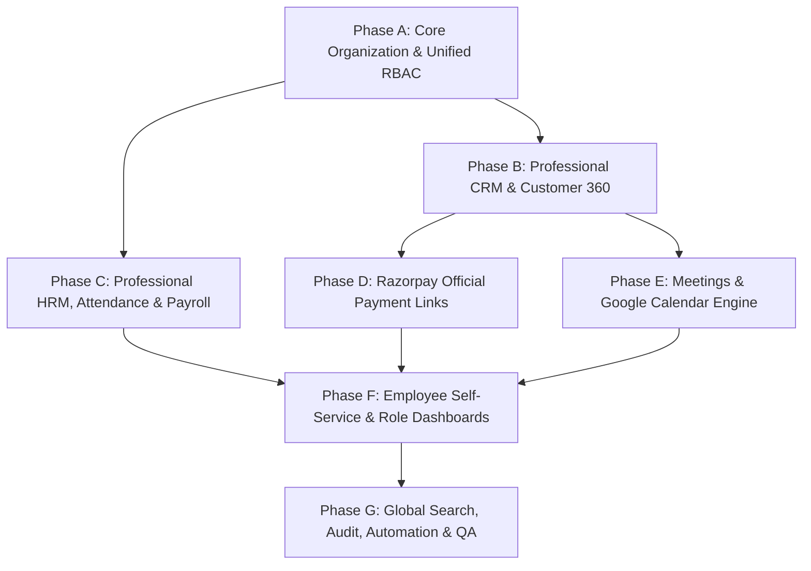

# TECHINPEDIA BUSINESS OS — PRODUCTION IMPLEMENTATION PLAN

**Document Version**: 1.0.0  
**Target Organization**: TechInPedia (~100 Employees)  
**Date**: September 18, 2026  
**Execution Horizon**: Phased Production Deployment (Additive, Non-Destructive)  
**Prerequisites**: Review and approval of `TECHINPEDIA_BUSINESS_OS_CURRENT_STATE.md` and `CRM_HRM_PRODUCTION_GAP_ANALYSIS.md`.

---

## 1. Architectural Strategy & Safety Directives

### 1.1 Non-Destructive Migration Principle
The production database (`<SERVER_USER>_techinpedianew`) contains live operational data across 75 tables. All schema updates must be **strictly additive**:
- No table drops or column deletions.
- All new foreign keys must initially be nullable to allow zero-downtime migration of existing rows.
- Use explicit Prisma migrations with staging dry-runs (`npx prisma migrate dev --create-only` and manual SQL review).

### 1.2 Anti-Complexity Principle (~100 Employee Pragmatism)
- Reject SAP/ERP-style multi-tiered overhead.
- Prioritize clean relational flows, automated status propagation, centralized audit trails, and role-scoped dashboards over dozens of configuration forms.

---

## 2. Implementation Phases Overview



---

## 3. Phase A: Core Organization Hierarchy & Unified RBAC

### 3.1 Objectives
1. Unify the decoupled `User` (Authentication) and `Employee` (HR) models into a cohesive identity graph.
2. Establish a non-hardcoded organizational hierarchy: `Department -> Team -> Team Leader -> Manager -> Employee`.
3. Transform the mock `/admin/roles` page into a functional database-backed RBAC engine with granular permission checks across all API endpoints.

### 3.2 Database Schema Enhancements (Prisma)
```prisma
// 1. Link User and Employee
model User {
  // Existing fields...
  employeeId       String?           @unique
  employee         Employee?         @relation(fields: [employeeId], references: [id])
  roleRecordId     String?
  roleRecord       Role?             @relation(fields: [roleRecordId], references: [id])
}

model Employee {
  // Existing fields...
  userId           String?           @unique
  user             User?
  
  // Org Hierarchy
  teamId           String?
  team             Team?             @relation("TeamMembers", fields: [teamId], references: [id])
  managerId        String?
  reportingManager Employee?         @relation("EmployeeHierarchy", fields: [managerId], references: [id])
  subordinates     Employee[]        @relation("EmployeeHierarchy")
  
  managedTeams     Team[]            @relation("TeamLeader")
  headedDepartment Department?       @relation("DepartmentHead")
}

model Team {
  id               String            @id @default(cuid())
  name             String
  code             String            @unique
  departmentId     String
  department       Department        @relation(fields: [departmentId], references: [id], onDelete: Cascade)
  leaderId         String?
  leader           Employee?         @relation("TeamLeader", fields: [leaderId], references: [id])
  members          Employee[]        @relation("TeamMembers")
  createdAt        DateTime          @default(now())
  updatedAt        DateTime          @updatedAt
}

model Department {
  // Existing fields...
  headId           String?           @unique
  head             Employee?         @relation("DepartmentHead", fields: [headId], references: [id])
  teams            Team[]
}

// 2. Real Database-Backed RBAC
model Role {
  id               String            @id @default(cuid())
  name             String            @unique // e.g. "SALES_MANAGER", "TEAM_LEADER", "HR_ADMIN", "EMPLOYEE"
  displayName      String
  description      String?
  isSystem         Boolean           @default(false)
  users            User[]
  permissions      RolePermission[]
  createdAt        DateTime          @default(now())
  updatedAt        DateTime          @updatedAt
}

model RolePermission {
  id               String            @id @default(cuid())
  roleId           String
  role             Role              @relation(fields: [roleId], references: [id], onDelete: Cascade)
  permissionKey    String            // e.g. "crm.deals.create", "hr.payroll.approve", "finance.payments.generate_link"
  createdAt        DateTime          @default(now())

  @@unique([roleId, permissionKey])
}
```

### 3.3 Backend Implementation Tasks
- **Auth Token Decoration**: Update `src/lib/auth.ts` session extraction to enrich session cookies with `employeeId`, `departmentId`, `teamId`, and loaded permission keys.
- **API Guard Middleware**: Replace raw `requireAuth()` calls in sensitive endpoints (`/api/hr/payroll`, `/api/crm/deals`, `/api/finance/payments`) with `requirePermission(session, 'permission.key')`.
- **Admin Roles Migration**: Hook `/admin/roles` to real CRUD APIs (`/api/admin/roles`) allowing dynamic permission assignment stored in the `RolePermission` table.

---

## 4. Phase B: Professional CRM & Customer 360

### 4.1 Objectives
1. Resolve `Enquiry` vs. `Lead` duplication by establishing a clear conversion pipeline.
2. Introduce a dedicated `FollowUp` task engine with overdue alert triggers.
3. Enhance Deals with stage histories, loss reasons, line-item services, and weighted revenue metrics.
4. Complete the Customer 360 view by linking all operational and financial touchpoints.

### 4.2 Database Schema Enhancements
```prisma
model Lead {
  // Existing fields...
  departmentId     String?
  department       Department?       @relation(fields: [departmentId], references: [id])
  teamId           String?
  team             Team?             @relation(fields: [teamId], references: [id])
  assignedEmployeeId String?
  assignedEmployee Employee?         @relation(fields: [assignedEmployeeId], references: [id])
  
  lostReason       String?
  lostNotes        String?           @db.Text
  wonDealId        String?           @unique
  wonDeal          Deal?             @relation("LeadToDeal", fields: [wonDealId], references: [id])
  
  followUps        FollowUp[]
}

model FollowUp {
  id               String            @id @default(cuid())
  leadId           String?
  lead             Lead?             @relation(fields: [leadId], references: [id], onDelete: Cascade)
  dealId           String?
  deal             Deal?             @relation(fields: [dealId], references: [id], onDelete: Cascade)
  assignedToId     String
  assignedTo       Employee          @relation(fields: [assignedToId], references: [id])
  scheduledAt      DateTime
  completedAt      DateTime?
  status           String            @default("PENDING") // PENDING, COMPLETED, OVERDUE, CANCELLED
  type             String            @default("CALL")    // CALL, WHATSAPP, EMAIL, MEETING
  notes            String?           @db.Text
  outcome          String?           @db.Text
  createdAt        DateTime          @default(now())
  updatedAt        DateTime          @updatedAt

  @@index([assignedToId, status, scheduledAt])
}

model Deal {
  // Existing fields...
  stageHistories   DealStageHistory[]
  lostReason       String?
  lostNotes        String?           @db.Text
  lead             Lead?             @relation("LeadToDeal")
  items            DealItem[]
  followUps        FollowUp[]
}

model DealStageHistory {
  id               String            @id @default(cuid())
  dealId           String
  deal             Deal              @relation(fields: [dealId], references: [id], onDelete: Cascade)
  fromStageId      String?
  toStageId        String
  changedById      String
  durationHours    Int?
  createdAt        DateTime          @default(now())
}

model DealItem {
  id               String            @id @default(cuid())
  dealId           String
  deal             Deal              @relation(fields: [dealId], references: [id], onDelete: Cascade)
  serviceName      String
  quantity         Int               @default(1)
  unitPrice        Decimal           @db.Decimal(12, 2)
  totalPrice       Decimal           @db.Decimal(12, 2)
}
```

### 4.3 UI & Workflow Tasks
- **Customer 360 Overhaul**: Update `/admin/crm/customers/[id]` to display a tabbed interface containing:
  - Overview & Primary Contacts
  - Deals & Sales Pipeline
  - Quotations & Proposals
  - Invoices, Payments & Payment Links
  - Delivery Projects & Milestones
  - Unified Chronological Activity Stream (calls, WhatsApp messages, emails, notes, system events)
- **Lead Follow-Up Widget**: Implement a prominent follow-up scheduler and overdue warning banner in `/admin/leads` and `/admin/crm/deals`.

---

## 5. Phase C: Professional HRM, Attendance & Payroll

### 5.1 Objectives
1. Implement employee self-service web clock-in/out with IP logging and automatic late/half-day detection.
2. Deploy a regularized attendance approval workflow.
3. Build a real `LeaveBalance` engine with multi-day/half-day tracking and automatic attendance synchronization.
4. Replace hardcoded payroll with attendance-driven compensation, approval stage gates, and PDF payslip downloads.

### 5.2 Database Schema Enhancements
```prisma
model Attendance {
  id               String            @id @default(cuid())
  employeeId       String
  employee         Employee          @relation(fields: [employeeId], references: [id], onDelete: Cascade)
  date             DateTime          @db.Date
  checkIn          DateTime?
  checkOut         DateTime?
  workMinutes      Int               @default(0)
  status           String            @default("PRESENT") // PRESENT, ABSENT, HALF_DAY, ON_LEAVE, HOLIDAY, WEEKLY_OFF
  isLate           Boolean           @default(false)
  isEarlyExit      Boolean           @default(false)
  ipAddress        String?
  regularized      Boolean           @default(false)
  regularizationReason String?
  notes            String?
  createdAt        DateTime          @default(now())
  updatedAt        DateTime          @updatedAt

  @@unique([employeeId, date])
}

model RegularizationRequest {
  id               String            @id @default(cuid())
  employeeId       String
  employee         Employee          @relation(fields: [employeeId], references: [id], onDelete: Cascade)
  date             DateTime          @db.Date
  requestedCheckIn DateTime
  requestedCheckOut DateTime
  reason           String            @db.Text
  status           String            @default("PENDING") // PENDING, APPROVED, REJECTED
  approvedById     String?
  approvedBy       Employee?         @relation("RegularizationApprover", fields: [approvedById], references: [id])
  managerNotes     String?
  createdAt        DateTime          @default(now())
  updatedAt        DateTime          @updatedAt
}

model LeaveBalance {
  id               String            @id @default(cuid())
  employeeId       String
  employee         Employee          @relation(fields: [employeeId], references: [id], onDelete: Cascade)
  year             Int
  leaveType        String            // CASUAL, SICK, PAID, UNPAID
  totalAllocated   Float
  used             Float             @default(0)
  pending          Float             @default(0)
  carriedForward   Float             @default(0)
  createdAt        DateTime          @default(now())
  updatedAt        DateTime          @updatedAt

  @@unique([employeeId, year, leaveType])
}

model Payroll {
  // Enhancements to existing Payroll model
  status           String            @default("DRAFT") // DRAFT, REVIEWED, APPROVED, LOCKED, PAID
  basicSalary      Decimal           @db.Decimal(12, 2)
  hra              Decimal           @db.Decimal(12, 2)
  specialAllowance Decimal           @db.Decimal(12, 2)
  grossSalary      Decimal           @db.Decimal(12, 2)
  
  totalDaysInMonth Int
  presentDays      Float
  paidLeaveDays    Float
  unpaidLeaveDays  Float
  lossOfPayDeduction Decimal         @default(0) @db.Decimal(12, 2)
  
  taxDeduction     Decimal           @default(0) @db.Decimal(12, 2)
  otherDeductions  Decimal           @default(0) @db.Decimal(12, 2)
  netSalary        Decimal           @db.Decimal(12, 2)
  
  reviewedById     String?
  approvedById     String?
  lockedAt         DateTime?
  paidAt           DateTime?
  paymentReference String?
}
```

### 5.3 Workflows & Calculation Engines
- **Attendance Processor**: Automated midnight calculation that evaluates punch timestamps against shift policies (e.g. punch after 09:30 = Late; total work < 240 mins = Absent; 240-480 mins = Half Day).
- **Payroll Generator**: Calculates `lossOfPayDeduction = (grossSalary / totalDaysInMonth) * unpaidLeaveDays`, generating accurate net compensation.
- **Payslip Generator**: Server-side React-PDF or Puppeteer generation producing standardized corporate payslips.

---

## 6. Phase D: Official Razorpay Payment Links & Webhook Engine

### 6.1 Objectives
1. Integrate official Razorpay Standard API & Payment Links SDK.
2. Implement server-side employee attribution (`createdByUserId`, `employeeId`, `departmentId`).
3. Deploy an idempotent, retry-safe webhook receiver verifying HMAC-SHA256 signatures.
4. Integrate the "Generate Payment Link" modal across Customer 360, Deals, and Invoices.

### 6.2 Database Schema Enhancements
```prisma
model PaymentLink {
  id               String            @id @default(cuid())
  providerLinkId   String            @unique // Razorpay plink_xxx
  shortUrl         String
  amount           Decimal           @db.Decimal(12, 2)
  currency         String            @default("INR")
  status           String            @default("CREATED") // CREATED, SENT, PAID, EXPIRED, CANCELLED, FAILED
  description      String
  purpose          String            // ADVANCE, MILESTONE, AMC, INVOICE, CUSTOM
  
  // Relations
  customerId       String?
  customer         Customer?         @relation(fields: [customerId], references: [id])
  leadId           String?
  lead             Lead?             @relation(fields: [leadId], references: [id])
  dealId           String?
  deal             Deal?             @relation(fields: [dealId], references: [id])
  invoiceId        String?
  invoice          Invoice?          @relation(fields: [invoiceId], references: [id])
  
  // Strict Staff Attribution
  createdByUserId  String
  createdByUser    User              @relation("PaymentLinkCreator", fields: [createdByUserId], references: [id])
  salesEmployeeId  String?
  salesEmployee    Employee?         @relation(fields: [salesEmployeeId], references: [id])
  departmentId     String?
  department       Department?       @relation(fields: [departmentId], references: [id])
  
  // Lifecycle & Tracking
  expiresAt        DateTime?
  paidAt           DateTime?
  providerPaymentId String?          // Razorpay pay_xxx
  notes            String?           @db.Text
  createdAt        DateTime          @default(now())
  updatedAt        DateTime          @updatedAt

  @@index([status, customerId, salesEmployeeId])
}

model PaymentWebhookEvent {
  id               String            @id @default(cuid())
  provider         String            @default("RAZORPAY")
  eventId          String            @unique // event_xxx
  eventType        String
  payloadJson      String            @db.LongText
  processed        Boolean           @default(false)
  errorMessage     String?           @db.Text
  createdAt        DateTime          @default(now())
}
```

### 6.3 Security Directives
- `RAZORPAY_KEY_ID` and `RAZORPAY_KEY_SECRET` must **never** be accessible on the client.
- Strict HMAC-SHA256 signature verification on `/api/webhooks/razorpay` using `crypto.createHmac('sha256', secret)`.
- Staff identity must be resolved exclusively from the authenticated session, rejecting any spoofed client headers.

---

## 7. Phase E: Meetings & Google Calendar Integration

### 7.1 Objectives
1. Implement a complete internal `Meeting` scheduling and tracking module.
2. Integrate Google Calendar API v3 with OAuth2 service credentials.
3. Automatically generate Google Meet video conference links and dispatch synchronized calendar invitations.
4. Record meeting outcomes, call summaries, and follow-ups on Customer and Lead timelines.

### 7.2 Database Schema Enhancements
```prisma
model Meeting {
  id               String            @id @default(cuid())
  title            String
  description      String?           @db.Text
  meetingType      String            @default("GOOGLE_MEET") // GOOGLE_MEET, PHONE_CALL, OFFICE, CUSTOM
  status           String            @default("SCHEDULED")   // SCHEDULED, COMPLETED, RESCHEDULED, CANCELLED, NO_SHOW
  
  startTime        DateTime
  endTime          DateTime
  timezone         String            @default("Asia/Kolkata")
  location         String?
  conferenceLink   String?           // Google Meet URL
  googleEventId    String?           @unique
  
  // Relations
  customerId       String?
  customer         Customer?         @relation(fields: [customerId], references: [id])
  leadId           String?
  lead             Lead?             @relation(fields: [leadId], references: [id])
  hostEmployeeId   String
  hostEmployee     Employee          @relation("MeetingHost", fields: [hostEmployeeId], references: [id])
  participants     MeetingParticipant[]
  
  outcome          String?           @db.Text
  notes            String?           @db.Text
  createdAt        DateTime          @default(now())
  updatedAt        DateTime          @updatedAt
}

model MeetingParticipant {
  id               String            @id @default(cuid())
  meetingId        String
  meeting          Meeting           @relation(fields: [meetingId], references: [id], onDelete: Cascade)
  employeeId       String?
  employee         Employee?         @relation(fields: [employeeId], references: [id])
  externalEmail    String?
  externalName     String?
  responseStatus   String            @default("NEEDS_ACTION") // ACCEPTED, DECLINED, TENTATIVE
}
```

---

## 8. Phase F: Role Dashboards & Employee Self-Service

### 8.1 Objectives
1. Build a streamlined Employee Self-Service (ESS) portal at `/portal` or `/admin/my-portal`.
2. Build dedicated, scoped dashboards for:
   - **Sales Executives & Team Members**: My Leads, My Deals, My Targets, My Tasks.
   - **Managers & Team Leaders**: Team Attendance, Pending Leave Approvals, Team Pipeline, Overdue Alerts.
   - **HR Team**: Real-time Daily Attendance (Present, Absent, Late), Pending Regularizations, Upcoming Lifecycle Events.
   - **Senior Management**: Executive Cashflow, Sales Forecasts, Realized vs. Projected Revenue, Delivery Health.

---

## 9. Phase G: Global Search, Automation & Final Production QA

### 9.1 Objectives
1. Implement a unified Omnibox Global Search (`/api/search/omni`) querying Leads, Customers, Deals, Employees, Invoices, and Projects with 150ms response times.
2. Expand the central Audit Logger with structured `before` and `after` diff tracking.
3. Wire background alerts via `jobQueue.ts` for overdue tasks, missed follow-ups, and pending approvals.
4. Execute comprehensive regression and performance testing on the live VPS environment.

---

## 10. Execution Timeline & Milestones

| Milestone | Target Scope | Risk Level | Database Impact |
| :--- | :--- | :---: | :--- |
| **Milestone 1** | Phase A (Org Hierarchy + Real RBAC) | High | Additive (New `Team`, `Role`, `RolePermission` tables; FK additions) |
| **Milestone 2** | Phase B (CRM Unification + Customer 360) | Medium | Additive (`FollowUp`, `DealStageHistory`, `DealItem`) |
| **Milestone 3** | Phase C (Punch In/Out + Leaves + Payroll) | High | Additive (`Attendance` punch fields, `LeaveBalance`, `RegularizationRequest`) |
| **Milestone 4** | Phase D (Razorpay Links + Webhook) | Medium | Additive (`PaymentLink`, `PaymentWebhookEvent`) |
| **Milestone 5** | Phase E (Meetings + Google Calendar) | Low | Additive (`Meeting`, `MeetingParticipant`) |
| **Milestone 6** | Phase F & G (Dashboards, Search, Audit, QA) | Low | UI & API endpoints; Zero schema mutations |
