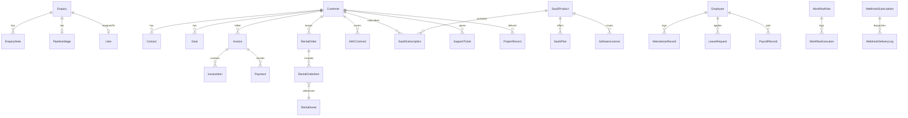

# TechInPedia Business OS — Complete Architecture & Reference Manual

## 1. Executive Summary

TechInPedia Business OS is a unified, enterprise-grade internal operating system built inside the existing TechInPedia Next.js production repository. It consolidates CRM, Sales Pipeline, Invoicing & Receivables, Omnichannel Communication (WhatsApp Cloud API, Live Chat, Email), IT Hardware Fleet Rentals, AMC Contracts, SaaS Subscriptions, Cryptographic Software Licensing, HRM (Attendance, Leaves, Payroll), Project Delivery, Support SLAs, Workflow Automation, and Executive Analytics into a single secure platform.

---

## 2. Technology Stack & Foundation

* **Framework**: Next.js 16 (App Router) + React 19
* **Language**: TypeScript 5
* **Styling**: Tailwind CSS v4 + Framer Motion
* **Database & ORM**: MySQL 8.x + Prisma ORM (51+ normalized models)
* **Authentication**: JWT in HttpOnly, Secure, SameSite=Lax cookies with Edge-compatible Middleware
* **Authorization**: RBAC 2.0 with 51 granular permission nodes and data visibility boundaries (OWN, TEAM, ALL)
* **Communication Integrations**:
  * Meta WhatsApp Cloud API (Graph API v21.0) with HMAC-SHA256 signature verification
  * Google Sheets Inbound Sync with automated duplicate detection
  * Nodemailer SMTP with modular HTML notification templates
* **Runtime Deployment**: cPanel Node.js Selector / Phusion Passenger compatible (`UV_THREADPOOL_SIZE = '1'`)

---

## 3. Database Architecture & Model Families



### Core Model Groups:
1. **Access Control & Users**: `User`, `Role`, `Permission`, `RolePermission`, `ActivityLog`
2. **CRM & Lead Scoring**: `Enquiry` (with dynamic scoring, temperature, stage, UTM fields), `EnquiryNote`, `Contact`, `Company`, `Customer`
3. **Pipeline & Deals**: `Pipeline`, `PipelineStage`, `Deal`, `FollowUp`
4. **Sales & Documentation**: `Quotation`, `QuotationItem`, `Proposal`, `Contract`
5. **Finance & Receivables**: `Invoice`, `InvoiceItem`, `Payment`, `Expense`
6. **Delivery & Engineering**: `ProjectRecord`, `Milestone`, `Task`, `Timesheet`
7. **Human Resources**: `Employee`, `Department`, `AttendanceRecord`, `LeaveRequest`, `PayrollRecord`
8. **Hardware Rentals & AMC**: `RentalAsset`, `RentalOrder`, `RentalOrderItem`, `AMCContract`, `AssetMaintenance`
9. **SaaS Products & Licenses**: `SaaSProduct`, `SaaSPlan`, `SaaSSubscription`, `SoftwareLicense`
10. **Support Desk**: `SupportTicket`, `TicketComment`, `KnowledgeArticle`
11. **Automation & Integrations**: `WorkflowRule`, `WorkflowExecution`, `SheetIntegration`, `WebhookSubscription`, `WebhookDeliveryLog`, `Notification`

---

## 4. Security & RBAC 2.0

### Server-Side Enforcement
Security is enforced on the server in every API route (`requireAuth()`, permission bitmask verification) and Edge Middleware (`src/middleware.ts`), rather than relying on hidden UI buttons.

### Granular Permission Matrix (`src/lib/permissions.ts`):
* **CRM**: `crm.leads.view`, `crm.leads.create`, `crm.leads.edit`, `crm.leads.delete`, `crm.leads.assign`, `crm.contacts.manage`, `crm.companies.manage`, `crm.customers.manage`
* **Sales**: `sales.deals.manage`, `sales.quotations.manage`, `sales.proposals.manage`, `sales.contracts.manage`
* **Finance**: `finance.invoices.manage`, `finance.payments.manage`, `finance.expenses.manage`, `finance.expenses.approve`
* **Projects**: `projects.view`, `projects.create`, `projects.edit`, `projects.tasks.manage`, `projects.timesheets.manage`
* **HRM**: `hr.employees.view`, `hr.employees.manage`, `hr.attendance.manage`, `hr.leaves.manage`, `hr.payroll.manage`, `hr.payroll.view_salary`
* **Support**: `support.tickets.manage`, `support.kb.manage`
* **Hardware & IT Rental**: `hardware.assets.manage`, `hardware.rentals.manage`, `hardware.amc.manage`
* **SaaS**: `saas.products.manage`, `saas.subscriptions.manage`, `saas.licenses.manage`
* **Automation & Admin**: `automation.workflows.manage`, `settings.integrations.manage`, `users.manage`, `audit.view`

`SUPER_ADMIN` bypasses all permission checks automatically.

---

## 5. End-to-End Operational Workflows

### 1. Inbound Lead to Customer & Project Delivery Flow
```
Visitor Submits Website / WhatsApp / Sheets Lead
  ↓
CRM Ingests Lead with UTM Attribution & Score (Cold / Warm / Hot)
  ↓
Round-Robin Lead Assignment & Automatic WhatsApp Greeting
  ↓
Deal Created on Kanban Stage (Discovery → Demo → Proposal → Negotiation)
  ↓
Quotation Generated (18% GST line items) & Proposal Dispatched
  ↓
Deal Closed WON:
  ├── Automatic Customer Account Created (Customer 360)
  ├── Internal Project Delivery Created (`ProjectRecord`)
  ├── Milestone & Tasks Created with Billable Hours Tracking
  └── Invoice Generated & Payment Tracked (Atomic Balance Updates)
```

### 2. IT Hardware Rental & AMC Fleet Flow
```
Rental Inquiry Received
  ↓
Customer Verified in Customer 360
  ↓
Available Devices Selected from Fleet Inventory (Laptops / Desktops / Servers)
  ↓
Rental Order Dispatched (Atomic transaction marks assets as RENTED)
  ↓
Monthly Rental Runrate & Security Deposit Recorded
  ↓
Return & Check-in: Marks Order RETURNED, releases assets to AVAILABLE
  ↓
AMC Contract Logged with Visit Frequency (Monthly / Quarterly) & SLA
  ↓
Maintenance Log & Repair Action Restores Service Readiness
```

### 3. SaaS Subscription & Licensing Flow
```
Client Onboards for Proprietary SaaS Product (e.g., Invoicely Cloud)
  ↓
Selects Tier Plan (Starter / Professional / Enterprise)
  ↓
Subscription Created (MRR / ARR Realized)
  ↓
Cryptographic Key Generated (`TIP-XXXX-XXXX-XXXX-XXXX`)
  ↓
Domain Bound & Seat Limits Enforced
  ↓
Renewal Cadence (30-Day Alerting & Status Management)
```

### 4. Workforce & HR Engine
```
Employee Profile Created with Department & Shift
  ↓
Daily Attendance Check-In / Check-Out Logged
  ↓
Leave Applications Reviewed & Approved by Manager
  ↓
Billable Timesheet Hours Logged against Client Projects
  ↓
Monthly Payroll Automatically Generated (Basic + Allowances - Deductions)
```

---

## 6. Integrations Architecture

### Meta WhatsApp Cloud API (`src/lib/whatsapp_cloud.ts`)
* Graph API v21.0 integration
* Inbound webhook validation with `hub.challenge` and `X-Hub-Signature-256`
* Automated message routing into the Unified Communication Inbox (`/admin/inbox`)
* Fallback configuration indicator (`NOT CONFIGURED` status banner when credentials are absent)

### Google Sheets Connector (`src/lib/google_sheets.ts`)
* Service account credentials authentication
* Bidirectional column mapping (Name, Phone, Email, Requirement, Source)
* Duplicate detection strategies: `SKIP`, `UPDATE`, `CREATE_NEW`

### Webhook Subscriptions (`/api/settings/webhooks`)
* Dispatches HMAC-SHA256 signed JSON payloads
* Header: `X-TechInPedia-Signature`
* Retains execution and response codes in `WebhookDeliveryLog`

---

## 7. Production Deployment Checklist

1. **Environment Configuration**:
   * Verify `.env` contains valid `DATABASE_URL`, `JWT_SECRET`, and `NEXT_PUBLIC_APP_URL`.
   * For WhatsApp Cloud API, provide `WHATSAPP_PHONE_NUMBER_ID`, `WHATSAPP_ACCESS_TOKEN`, `WHATSAPP_WEBHOOK_VERIFY_TOKEN`, `WHATSAPP_APP_SECRET`.
   * For Email notifications, provide `SMTP_HOST`, `SMTP_PORT`, `SMTP_USER`, `SMTP_PASS`, `SMTP_FROM`.
2. **Database Sync**:
   * Run `npx prisma db push` or `npx prisma migrate deploy`
   * Run `node prisma/seed_business_os.js` to initialize default roles, permissions, pipelines, and departments.
3. **Build & Type Check**:
   * Run `npx tsc --noEmit` to confirm 0 compilation errors.
   * Run `npm run build` to create optimized standalone distribution.
4. **Reverse Proxy & Cookies**:
   * In production HTTPS, cookies automatically set `Secure: true` and `SameSite: 'lax'`.
